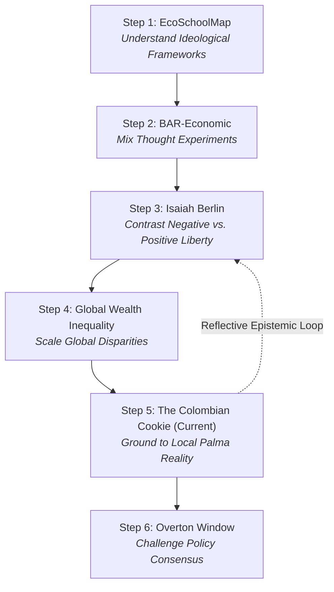
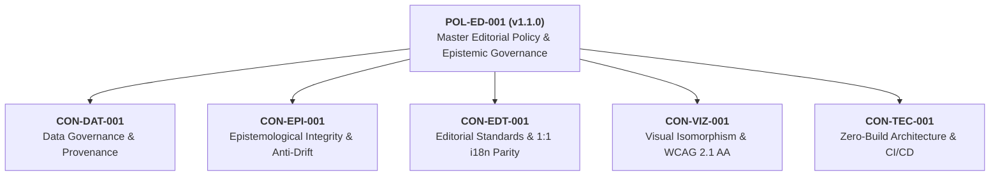

# 🍪 The Colombian Cookie · Step 5 (La Galleta Colombiana)
### *Interactive Data Essay, Empirical Modeling, and Epistemological Governance of Income Concentration in Colombia via the Palma Ratio (2002–2023).*
### *Visualización interactiva, modelado empírico y gobernanza epistemológica de la concentración de ingresos en Colombia a través del Coeficiente de Palma (2002–2023).*

---

[](https://willkwolf.github.io/colombia-palma-desigualdad/)
[](https://willkwolf.github.io/colombia-palma-desigualdad/openwiki/)
[](https://github.com/willkwolf/colombia-palma-desigualdad)
[](openwiki/03-contratos-y-tests/06-policy-editorial-maestra.md)
[](https://creativecommons.org/licenses/by/4.0/)
[](openwiki/02-tecnologia-y-arquitectura/03-accesibilidad-wcag-a11y.md)

---

## 🌐 Live Interactive Application & Documentation Hub
- **👉 [Interactive Visual Essay (GitHub Pages)](https://willkwolf.github.io/colombia-palma-desigualdad/)**
- **📖 [Canonical OpenWiki Documentation Hub](https://willkwolf.github.io/colombia-palma-desigualdad/openwiki/)**
- **📊 [Open Data Portal (`/data`)](data/provenance.md)**

---

## 1. Overview
**The Colombian Cookie (La Galleta Colombiana)** is an interactive data essay and academic repository that investigates income distribution and elite concentration in Colombia over two decades (2002–2023).

Using Chilean economist **José Gabriel Palma's** seminal framework (University of Cambridge), the project cuts through the mathematical abstractions of the traditional Gini Coefficient to illuminate where distributional struggles actually happen: not in the middle class, but between the richest decile and the bottom 40% of the population.

The artifact integrates:
1. **Interactive Waffle Chart:** A pedagogical and isomorphic simulation condensing national income into *100 cookies*, demonstrating how 10 individuals take 45 cookies while 40 share just 12.
2. **Tufte Range-Frame Line Chart:** A zero-chartjunk dynamic SVG graph plotting Colombia's historical Palma trajectory ($3.7$ to $4.9$) without distorting the empirical baseline.
3. **Epistemological Closing Loop:** A conceptual bridge linking material inequality with the philosophical dilemma between negative liberty and Amartya Sen's capability approach, returning the reader to **Step 3 (*Isaiah Berlin and the Philosophy of Liberty*)**.

---

## 2. Research Context: The Critical Thinking Pathway
This project is **Step 5 ("Ground / Aterrizar")** of **"The Critical Thinking Pathway" (La Ruta del Pensamiento Crítico)**, a 6-node network of interactive web essays authored by William Camilo Artunduaga Viana (`@willkwolf`):



> [!NOTE]
> In Step 4, users examine the planetary scale of wealth accumulation. In Step 5, that analysis is grounded in Colombia's institutional reality. When extreme material inequality hollows out formal rights, the user is invited to reassess the limits of political freedom, **re-entering Step 3 to close the philosophical loop**.

---

## 3. Conceptual Framework

### 3.1. Gabriel Palma's Empirical Law: Middle Class Stability
Gabriel Palma (2011, 2014) observed that across high-, middle-, and low-income nations, the middle 50% of the population (deciles 5 to 9) consistently captures **approximately half of national disposable income** ($\approx 50\% \pm 5\%$). Because the middle share is remarkably stable across diverse political regimes, national inequality is determined by the appropriation battle between the top 10% ($D_{10}$) and the bottom 40% ($\sum_{1}^{4} D_i$):

$$\text{Palma Ratio} = \frac{\text{Income Share of Decile 10}}{\text{Income Share of Deciles 1 to 4}} = \frac{D_{10}}{\sum_{i=1}^{4} D_i}$$

### 3.2. Interpreting the Benchmark
- **Palma $\approx 1.0$:** Parity between extremes (Nordic welfare states: Norway $0.9$, Germany $1.1$).
- **Palma $\approx 2.0$:** Moderate to high inequality among advanced economies (United States $2.0$).
- **Palma $\ge 3.5$:** Severe structural concentration (Colombia has fluctuated between **$3.7$ and $4.9$**; South Africa reaches $7.0$).

---

## 4. Repository Architecture
The repository is organized following an orthogonal four-tier architecture that decouples empirical data, theoretical conceptualization, governance contracts, and visual presentation:

```
colombia-palma-desigualdad/
├── data/                                 # 1. DATA LAYER (Canonical empirical sources)
│   ├── schemas/                          # JSON Schemas (Draft-07 validation)
│   │   ├── palma_series.schema.json
│   │   └── distribution.schema.json
│   ├── palma_colombia_series.json        # Official 2002-2023 DANE series (structured)
│   ├── palma_colombia_series.csv         # Tabular open-data format
│   ├── palma_cookie_distribution.json    # Decile allocation for the 100-cookie model
│   ├── global_palma_comparison.json      # International benchmarks (OECD / LatAm)
│   └── provenance.md                     # Source audit trail and methodological limits
│
├── docs/                                 # 2. DOCUMENTATION & GOVERNANCE HIERARCHY
│   ├── README.md                         # Master documentation index
│   ├── diagnostico_repositorio.md        # Comprehensive diagnostic & sanity report
│   ├── conceptualizacion/                # Theoretical foundations & economic models
│   │   ├── teorema_de_palma.md
│   │   ├── trayectoria_historica_colombia.md
│   │   ├── puntos_ciegos_metodologicos.md
│   │   ├── politica_fiscal_y_desigualdad.md
│   │   └── cierre_etico_y_libertad.md
│   ├── metodologia/                      # Architecture, A11y & Tufte visual system
│   │   ├── arquitectura_zero_build.md
│   │   ├── sistema_visual_tufte.md
│   │   ├── accesibilidad_wcag_a11y.md
│   │   └── motor_internacionalizacion.md
│   ├── contratos/                        # Master Governance Contracts (CON-* & POL-*)
│   │   ├── CON-DAT-001_gobernanza_datos.md
│   │   ├── CON-EPI-001_gobernanza_epistemologica.md
│   │   ├── CON-EDT-001_gobernanza_editorial.md
│   │   ├── CON-VIZ-001_gobernanza_visual.md
│   │   ├── CON-TEC-001_gobernanza_tecnica.md
│   │   └── POL-ED-001_policy_editorial_maestra.md
│   └── auditoria/                        # Official Audit Reports & E-ADRs
│       ├── AUDIT_REPORT.md
│       └── E-ADR/
│           └── E-ADR-001-desacoplamiento-datos-arquitectura-monolitica.md
│
├── openwiki/                             # 3. OPENWIKI KNOWLEDGE BASE (Docsify SPA)
│   ├── index.html                        # Docsify interactive documentation reader
│   ├── _sidebar.md                       # Structured sidebar navigation
│   ├── README.md                         # Knowledge hub landing page
│   ├── 01-marco-teorico/                 # Theory domain
│   ├── 02-tecnologia-y-arquitectura/     # Technology domain
│   ├── 03-contratos-y-tests/             # Master contracts domain
│   └── 04-auditoria/                     # Audits and decision records domain
│
├── .github/workflows/deploy.yml          # CI/CD: Automated HTML5 linting & Pages deployment
├── index.html                            # 4. PRESENTATION LAYER (Archival-Safe Monolith)
└── README.md                             # Repository entry point (Current document)
```

---

## 5. Data and Sources

| Dataset File | Format | Coverage | Primary Source | Validation Schema |
| :--- | :---: | :---: | :--- | :--- |
| [`palma_colombia_series.json`](data/palma_colombia_series.json) | JSON | 2002–2023 | DANE · GEIH / MESEP | `palma_series.schema.json` |
| [`palma_colombia_series.csv`](data/palma_colombia_series.csv) | CSV | 2002–2023 | DANE · GEIH / MESEP | RFC 4180 Tabular |
| [`palma_cookie_distribution.json`](data/palma_cookie_distribution.json) | JSON | Static (2023) | DANE · GEIH 2023 | `distribution.schema.json` |
| [`global_palma_comparison.json`](data/global_palma_comparison.json) | JSON | Cross-Country | World Bank WDI / ECLAC | `distribution.schema.json` |

Full provenance metadata, survey splicing methodologies, and variable definitions are formalized in [`data/provenance.md`](data/provenance.md).

---

## 6. Methodology & Methodological Blind Spots
Following **Popperian fallibilism**, the project explicitly documents what its metrics do and do not capture:

1. **Flow vs. Wealth Stock:** The GEIH captures annual disposable income (wages, pensions, cash transfers, imputed rent). It does **not** capture land ownership (where Colombia's Gini exceeds $0.88$) or offshore financial assets. Wealth inequality is estimated to be three to four times higher.
2. **Top Coding and Capital Underreporting:** The top $1\%$ and $0.1\%$ systematically underreport capital gains and dividends in household surveys. Administrative tax data from DIAN indicate that Colombia's true Palma ratio exceeds $5.0$.
3. **Territorial Aggregation Fallacy:** The national average ($3.7$) masks extreme subnational divides. Pacific and Caribbean peripheries (Chocó, La Guajira) face poverty rates above $55\%$ and local Palma ratios higher than $5.0$.

See full analysis in [`docs/conceptualizacion/puntos_ciegos_metodologicos.md`](docs/conceptualizacion/puntos_ciegos_metodologicos.md).

---

## 7. Master Governance System

The repository is governed by five master contracts codified in `/docs/contratos/` and synthesized by the canonical **Master Editorial Policy POL-ED-001 (v1.1.0)**:



### Autonomy and Anti-Drift Matrix
- **Tier 1 (Autonomous Remediation):** AI agents and automated tools may directly remediate syntax, typos, broken links, contrast tokens, schema validation, and WCAG accessibility issues.
- **Tier 2 (Human Custodian Sign-off):** Any change affecting core economic theses, empirical baselines, value trade-offs, or conceptual definitions constitutes **Conceptual Drift** and requires explicit written authorization via an **Editorial Architecture Decision Record (E-ADR)** signed by the Conceptual Custodian (`@willkwolf`).

---

## 8. Visual Artifacts and Ergonomics
- **Tufte Principles:** High data-ink ratio, range-frame coordinate bounds, zero decorative chartjunk.
- **Isomorphism:** Every graphic vector encodes verifiable mathematical relationships.
- **Accessibility (WCAG 2.1 AA):**
  - Minimum contrast ratio of $\ge 4.5:1$ on text and $\ge 3.0:1$ on interactive components.
  - Skip link (`#main-content`) and full keyboard operability.
  - Generous touch targets ($\ge 44 \times 44\text{ px}$) on mobile devices.
  - Screen-reader text (`.sr-only`) accompanying all visual plots.

---

## 9. Reproducibility & Zero-Build Local Usage

The web application requires **zero build steps, zero node_modules, and zero external compilation**:

```bash
# 1. Clone the repository
git clone https://github.com/willkwolf/colombia-palma-desigualdad.git
cd colombia-palma-desigualdad

# 2. Open index.html directly in any web browser
# (Windows)
start index.html
# (macOS)
open index.html
# (Linux)
xdg-open index.html

# 3. (Optional) Run a local zero-config server
npx live-server
```

To explore the OpenWiki knowledge base locally:
```bash
# Open openwiki/index.html in browser or serve via live-server
npx live-server --entry-file=openwiki/index.html
```

---

## 10. References and Citation

### Academic Reference (APA 7th Edition)
> Artunduaga Viana, W. C. (2026). *La Galleta Colombiana: Radiografía de la Desigualdad y Análisis Crítico del Coeficiente de Palma en Colombia* [Interactive data essay and epistemological repository]. GitHub. https://github.com/willkwolf/colombia-palma-desigualdad

### BibTeX Entry
```bibtex
@software{artunduaga2026palma,
  author    = {Artunduaga Viana, William Camilo},
  title     = {La Galleta Colombiana: Radiograf{\'i}a de la Desigualdad},
  year      = {2026},
  publisher = {GitHub},
  url       = {https://github.com/willkwolf/colombia-palma-desigualdad},
  note      = {Visualizaci{\'o}n cr{\'i}tica interactiva del Coeficiente de Palma en Colombia con microdatos del DANE y gobernanza OpenWiki}
}
```

---

## 11. License
This repository, its interactive visual essay, documentation, datasets, and OpenWiki knowledge base are published under the **Creative Commons Attribution 4.0 International License (CC BY 4.0)**.

[](https://creativecommons.org/licenses/by/4.0/)

You are free to:
- **Share:** Copy and redistribute the material in any medium or format.
- **Adapt:** Remix, transform, and build upon the material for any purpose, even commercially.
- **Attribution:** You must give appropriate credit to William Camilo Artunduaga Viana, provide a link to the license, and indicate if changes were made.
