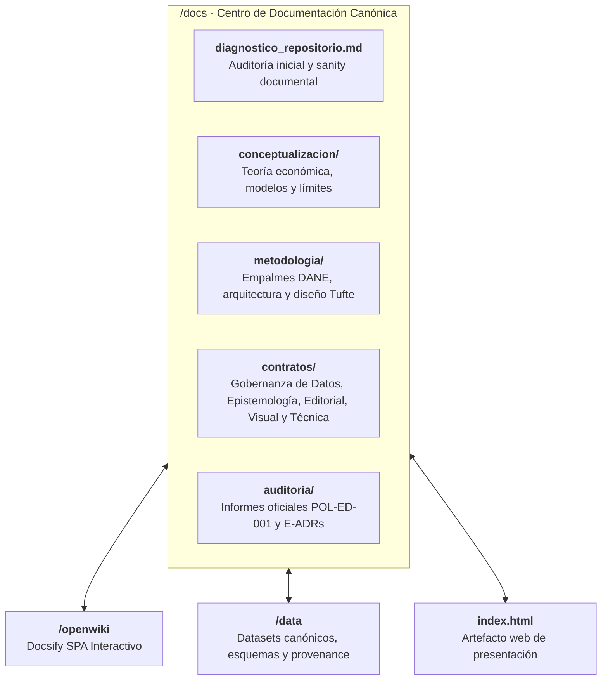

# Índice Maestro de Documentación y Gobernanza del Repositorio
## Repositorio: colombia-palma-desigualdad (Paso 5: La Galleta Colombiana)
**Código Documental:** DOC-INDEX-001  
**Autor:** William Camilo Artunduaga Viana (`@willkwolf`)  
**Licencia:** CC BY 4.0  
**Centro de Documentación Interactivo:** [OpenWiki](../openwiki/index.html)

---

## 1. Estructura Canónica de la Documentación

Toda la documentación académica, metodológica y técnica se organiza en este directorio bajo una estricta separación de responsabilidades:

---

## 2. Mapa de Contenidos

### 2.1. Diagnóstico y Sanity
- [`diagnostico_repositorio.md`](diagnostico_repositorio.md): Informe exhaustivo de la auditoría inicial de archivos, clasificación y plan de consolidación.

### 2.2. Conceptualización (`docs/conceptualizacion/`)
- [`teorema_de_palma.md`](conceptualizacion/teorema_de_palma.md): Hipótesis de invarianza de la clase media (50% medio) y formulación matemática del ratio $D_{10} / D_{1-4}$.
- [`trayectoria_historica_colombia.md`](conceptualizacion/trayectoria_historica_colombia.md): Análisis de cuatro fases históricas en Colombia (2002–2023).
- [`puntos_ciegos_metodologicos.md`](conceptualizacion/puntos_ciegos_metodologicos.md): Flujo vs. riqueza (Gini 0.88), subreporte en decil 10 y asimetría territorial.
- [`politica_fiscal_y_desigualdad.md`](conceptualizacion/politica_fiscal_y_desigualdad.md): Dependencia del IVA, ausencia de tributación progresiva directa y fractura cívica.
- [`cierre_etico_y_libertad.md`](conceptualizacion/cierre_etico_y_libertad.md): Conexión reflexiva con el Paso 3 (*Amartya Sen, Isaiah Berlin y la colisión trágica de valores*).

### 2.3. Metodología y Arquitectura (`docs/metodologia/`)
- [`arquitectura_zero_build.md`](metodologia/arquitectura_zero_build.md): Principios de auto-suficiencia sin frameworks, preservación a 30 años.
- [`sistema_visual_tufte.md`](metodologia/sistema_visual_tufte.md): Range-frame SVG, ratio datos-tinta y waffle chart isomórfico.
- [`accesibilidad_wcag_a11y.md`](metodologia/accesibilidad_wcag_a11y.md): Certificación WCAG 2.1 AA, navegación por teclado y lectores de pantalla.
- [`motor_internacionalizacion.md`](metodologia/motor_internacionalizacion.md): Motor declarativo bilingüe (ES/EN) sin dependencias.

### 2.4. Contratos Maestros de Gobierno (`docs/contratos/`)
- [`CON-DAT-001_gobernanza_datos.md`](contratos/CON-DAT-001_gobernanza_datos.md): Procedencia, validación por esquemas y reglas de actualización.
- [`CON-EPI-001_gobernanza_epistemologica.md`](contratos/CON-EPI-001_gobernanza_epistemologica.md): Rigor conceptual, falibilismo y blindaje anti-drift.
- [`CON-EDT-001_gobernanza_editorial.md`](contratos/CON-EDT-001_gobernanza_editorial.md): Calidad de prosa, paridad lingüística 1:1 y citación APA 7 / BibTeX.
- [`CON-VIZ-001_gobernanza_visual.md`](contratos/CON-VIZ-001_gobernanza_visual.md): Isomorfismo gráfico, contraste y dimensiones táctiles $\ge 44 \times 44\text{ px}$.
- [`CON-TEC-001_gobernanza_tecnica.md`](contratos/CON-TEC-001_gobernanza_tecnica.md): Zero-Build, rutas relativas y CI/CD determinístico.
- [`POL-ED-001_policy_editorial_maestra.md`](contratos/POL-ED-001_policy_editorial_maestra.md): Norma canónica transversal v1.1.0 (8 vectores, matriz de autonomía y anexos).

### 2.5. Auditoría Epistemológica (`docs/auditoria/`)
- [`AUDIT_REPORT.md`](auditoria/AUDIT_REPORT.md): Informe oficial emitido por el Agente Auditor Epistemológico.
- [`E-ADR/`](auditoria/E-ADR/): Registros de Decisiones Editoriales formalmente documentados.
