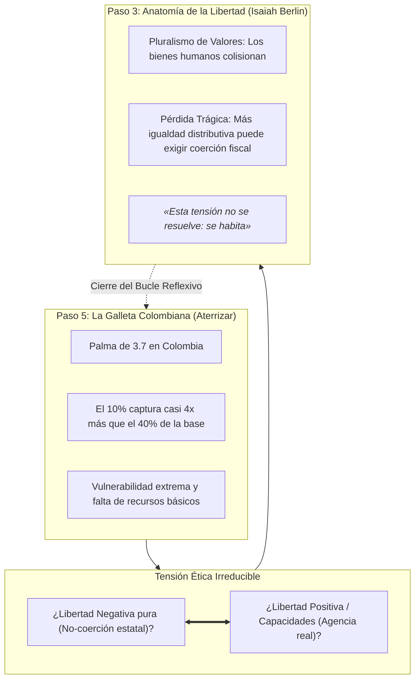

# 05. Cierre Ético: El Bucle Hacia la Libertad (Retorno al Paso 3)

> **Metadatos Canónicos:**  
> - **Dominio:** Dominio I — Marco Teórico y Conceptualización  
> - **Propósito:** Articular la dimensión material de la desigualdad en Colombia con el debate filosófico de la libertad, demostrando el cierre epistemológico de «La Ruta del Pensamiento Crítico» que conecta el Paso 5 con el Paso 3 (*Isaiah Berlin*).  
> - **Audiencia:** Filósofos políticos, teóricos de la justicia distributiva, estudiantes de humanidades y agentes de integración conceptual.  
> - **Alcance:** Tensión entre libertad formal y libertad sustantiva, enfoque de capacidades de Amartya Sen y pluralismo de valores de Isaiah Berlin.  
> - **Límites de Validez:** Discusión meta-teórica y normativa; no sustituye los análisis empíricos econométricos sino que los dota de sentido moral.

---

## 1. De las Galletas a la Filosofía Política: La Ilusión de la Libertad Formal

El estudio cuantitativo del Coeficiente de Palma en Colombia no es un mero ejercicio de contabilidad social; es el punto de apoyo empírico para cuestionar las definiciones abstractas de la libertad.

Cuando un orden económico asigna **12 galletas a 40 personas** y **45 galletas a 10 personas**, la noción clásica de *Libertad Negativa* (entendida en los términos de Isaiah Berlin como la mera ausencia de interferencia estatal o coacción física intencional de terceros) entra en una crisis conceptual insalvable:

> *«¿De qué le sirve a un hombre hambriento o descalzo la libertad formal de transar, contratar o circular libremente si carece del pan para sobrevivir y de los zapatos para caminar?»*  
> — Reflexión berliniana sobre los límites de la no-interferencia.

---

## 2. El Enfoque de Capacidades de Amartya Sen

En contraste con el libertarismo formal, el economista y filósofo **Amartya Sen** (*Development as Freedom*, 1999) sostiene que el desarrollo no es el incremento del PIB ni la mera preservación de derechos civiles formales, sino la **expansión de las libertades reales (capacidades)** que las personas tienen para llevar la vida que valoran.

1. **Factores de Conversión:** Dos individuos con el mismo ingreso nominal poseen libertades distintas según sus condiciones biológicas, geográficas y sociales (ej. un enfermo crónico en Chocó frente a una persona sana en Bogotá).
2. **Capacidades Básicas Destruidas:** En una sociedad donde el decil inferior captura solo el 1.5% del ingreso, libertades tan esenciales como:
   - Evitar la muerte prematura por causas prevenibles,
   - Acceder a educación formativa que desarrolle el pensamiento crítico,
   - Participar activamente en la vida pública sin vergüenza social,  
   quedan amputadas para cuatro de cada diez ciudadanos.

---

## 3. El Conflicto Trágico de Valores y el Cierre de la Ruta

Siguiendo el mandato de la **Policy Editorial Maestra POL-ED-001 (Sección 6 — Salvaguarda Anti-Aplanamiento)**, este proyecto **rechaza categóricamente la tentación de ofrecer una solución armónica ficticia**:

* Por un lado, exigir que el Coeficiente de Palma descienda a 1.2 requiere necesariamente una intervención estatal profunda sobre los derechos de propiedad, impuestos confiscatorios a las grandes rentas y regulaciones de precios que restringen la esfera de *libertad negativa* de los individuos más prósperos.
* Por otro lado, priorizar la no-interferencia absoluta y la inmunidad del mercado libre condena al 40% de los colombianos a una vida de privación material que vacía de contenido práctico sus derechos constitucionales.

**Conclusión Epistémica:**  
La desigualdad extrema de ingresos en Colombia no es un simple problema técnico de calibración fiscal; es la manifestación viva del **conflicto trágico entre libertad e igualdad**. Por ello, tras examinar los datos de este repositorio, el lector es convocado a regresar al **Paso 3 (*Filosofía de la Libertad*)**, reconociendo que ninguna fórmula tecnocrática puede eludir la elección moral ineludible de qué costo ético está dispuesta a pagar una sociedad por la justicia distributiva.
