# 03. Puntos Ciegos y Límites Metodológicos del Indicador

> **Metadatos Canónicos:**  
> - **Dominio:** Dominio I — Marco Teórico y Conceptualización  
> - **Propósito:** Explicitar con rigor falibilista los límites del Coeficiente de Palma y advertir sobre las distorsiones inherentes a las encuestas de hogares del DANE.  
> - **Audiencia:** Investigadores empíricos, econometristas, docentes y agentes de evaluación metodológica.  
> - **Alcance:** Evaluación de tres puntos ciegos: flujo vs. stock de riqueza, subreporte del percentil superior y asimetría territorial.  
> - **Criterio Epistemológico:** Falibilismo Popperiano (declaración explícita de lo que el dato NO mide).

---

## 1. El Conflicto Epistémico: Flujo Monetario vs. Stock de Riqueza

El Coeficiente de Palma calculado a partir de la GEIH mide exclusivamente **flujos monetarios corrientes anualizados** (ingreso disponible per cápita). Esto introduce un sesgo de atenuación sobre la magnitud real de la asimetría material en Colombia:

```mermaid
graph LR
    subgraph Flujo["Flujo Anual (Lo que MIDE la GEIH)"]
        F1["Salarios Líquidos"]
        F2["Pensiones Corrientes"]
        F3["Subsidios Monetarios Directos"]
        F4["Arriendo Imputado de Vivienda"]
        F5["<b>Coeficiente de Palma: 3.7</b>"]
    end

    subgraph Stock["Stock Acumulado (Lo que NO MIDE)"]
        S1["Propiedad de la Tierra Rural (Gini > 0.88)"]
        S2["Portafolios de Acciones Financieras y Dividendos"]
        S3["Activos en Sociedades y Holdings Familiares"]
        S4["Cuentas y Fideicomisos Offshore"]
        S5["<b>Gini de Riqueza Estimado: > 0.85</b>"]
    end

    Flujo -.->|"Representa solo el 20-25% de la disparidad material real"| Stock
```

* **Desigualdad de la Tierra:** Colombia posee una de las concentraciones de tierra rural más extremas del mundo (Gini de tierras catastrales superior a **0.88** según el Instituto Geográfico Agustín Codazzi - IGAC y la UPRA). Menos del 1% de las fincas acapara más del 80% del suelo productivo.
* **Capital Financiero:** La tenencia de títulos de deuda, participaciones societarias y activos especulativos genera plusvalías latentes que nunca son capturadas por los cuestionarios de encuestas a hogares.

---

## 2. El Truncamiento Superior: La Invisibilidad de los Multimillonarios

Las encuestas de hogares en Colombia (y en toda América Latina) sufren del conocido problema del **subreporte y truncamiento del extremo superior** (*Top Coding / Non-Response Bias*):

1. **Sesgo de Muestreo:** Las familias pertenecientes al percentil $99.9$ residen en áreas residenciales de alta seguridad donde los encuestadores del DANE no tienen acceso efectivo.
2. **Subreporte Intencional:** Aquellos hogares de ingresos extraordinarios que acceden a responder la encuesta tienden a ocultar dividendos, herencias, utilidades corporativas o rentas del extranjero por motivos de privacidad, seguridad o evasión fiscal.
3. **Implicación Cuantitativa:** Investigaciones que cruzan microdatos de encuestas con registros tributarios administrativos de la DIAN (como los trabajos de Thomas Piketty, Facundo Alvaredo, Juliana Londoño-Vélez y Marc Morgan) demuestran que:
   - El 1% más rico de Colombia captura no el 15-20% que sugiere la GEIH, sino más del **20-25%** del ingreso nacional.
   - Si se ajusta la serie empalmada con microdatos de la DIAN, **el Coeficiente de Palma real de Colombia superaría los 5.0 o 5.5 puntos**.

---

## 3. La Falacia del Promedio Nacional: El Espejismo Territorial

Un Coeficiente de Palma nacional de **3.7** es una abstracción estadística que suaviza y homogeneiza fracturas territoriales abismales:

| Región / Departamento | Tasa de Pobreza Monetaria | Estimación de Palma Local | Característica Distributiva |
| :--- | :---: | :---: | :--- |
| **Bogotá D.C.** | $\approx 24\%$ | $3.2 - 3.4$ | Mayor concentración de asalariados formales de clase media y alta densidad de servicios. |
| **Antioquia (Medellín/Valle de Aburrá)** | $\approx 27\%$ | $3.5 - 3.8$ | Tejido industrial maduro, pero alta segregación espacial entre laderas y valles. |
| **Pacífico (Chocó, Cauca, Nariño)** | $> 60\%$ | $> 5.2$ | Economías de subsistencia, ausencia de bienes públicos e informalidad laboral $>75\%$. |
| **Caribe Periférico (La Guajira, Sucre)** | $> 55\%$ | $> 4.8$ | Escasa captura de rentas mineras en las comunidades locales y precarización hídrica/alimentaria. |

> **Principio de Cautela Interpretativa:**  
> Afirmar que Colombia tiene un Palma de 3.7 es metodológicamente correcto a nivel de agregación macroeconómica, pero encubre que amplias regiones de la geografía nacional conviven con índices distributivos propios de economías de subsistencia africanas, mientras que enclaves metropolitanos emulan estándares de ingreso medio-alto.
