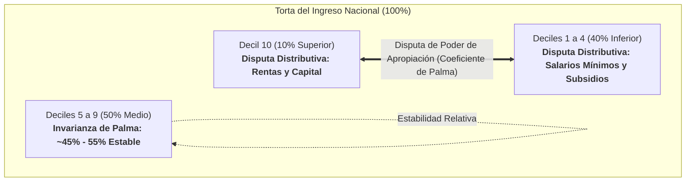

# 01. Fundamentos Teóricos: El Teorema de Palma y la Disputa en los Extremos

> **Metadatos Canónicos:**  
> - **Dominio:** Dominio I — Marco Teórico y Conceptualización  
> - **Propósito:** Fundamentar la mecánica analítica del Coeficiente de Palma, justificar su superioridad frente al Gini para economías en desarrollo y formalizar la hipótesis del 50% medio estable.  
> - **Audiencia:** Investigadores en economía política, analistas de políticas públicas, sociólogos y agentes de auditoría.  
> - **Alcance:** Formulación teórica, demostración matemática y comparación epistemológica con el índice de Gini.  
> - **Límites de Validez:** Análisis de flujos de ingresos corrientes en unidades de gasto; no abarca tenencia de activos físicos ni patrimonio financiero.

---

## 1. El Dilema del Índice de Gini y la Ceguera Central

Durante más de un siglo, el **Coeficiente de Gini** ha sido el indicador hegemónico para cuantificar la desigualdad económica. Sin embargo, en el análisis distributivo contemporáneo adolece de una debilidad matemática estructural: **es hiper-sensible a las transferencias en el centro de la distribución y relativamente insensible a los movimientos extremos en las colas**.

Debido a que el Gini calcula el área bajo la Curva de Lorenz ponderada por la densidad poblacional, los desplazamientos de ingreso entre las clases medias generan variaciones desproporcionadas en el coeficiente final, mientras que la captura astronómica de rentas por parte del 10% o 1% superior queda amortiguada en el promedio agregado. Dos países con estructuras sociales radicalmente distintas (uno con una clase media pauperizada pero colas moderadas, y otro con una clase media sólida pero una élite oligárquica que acapara el excedente) pueden arrojar un coeficiente de Gini idéntico ($\approx 0.52$).

---

## 2. La Proposición de Gabriel Palma: La Invarianza del Centro

En una serie de investigaciones pioneras en la Universidad de Cambridge (2011, 2014), el economista chileno **José Gabriel Palma** identificó una regularidad empírica asombrosa al analizar series de datos de más de 130 países a lo largo de cuatro décadas:

> **Teorema de la Estabilidad Central:**  
> Independientemente del régimen político, la dotación de recursos naturales, la geografía o el grado de desarrollo, **la mitad intermedia de la población (los deciles 5 al 9) captura de forma casi constante cerca del 50% del ingreso nacional disponible** (típicamente entre el 45% y el 53%).

Esta «mitad del centro» (conformada por la clase trabajadora formal, profesionales asalariados y pequeños propietarios) posee el poder de negociación política y sindical suficiente para defender su cuota proporcional del producto social ($1:1$, 50% de la población capturando 50% del ingreso), pero carece del poder hegemónico para apropiarse del excedente restante.

---

## 3. Formulación Matemática del Ratio de Palma

Al demostrarse que la clase media actúa como un componente casi invariable en la ecuación distributiva, Palma propuso eliminar el «ruido» del centro y medir directamente la relación de fuerza distributiva entre los extremos de la pirámide:

$$\text{Palma Ratio} = \frac{\text{Participación del Decil 10 } (D_{10})}{\text{Participación de los Deciles 1 al 4 } (\sum_{i=1}^{4} D_i)}$$

### Interpretación Numérica Directa:
* **Palma = 1.0:** El 10% más rico recibe colectivamente la misma porción del pastel social que el 40% más vulnerable de la población. Representa el umbral típico de las sociedades con estados de bienestar robustos (Dinamarca, Noruega, Japón).
* **Palma = 2.0:** La élite superior captura el doble que las cuatro décimas partes más pobres combinadas (Estados Unidos, Reino Unido).
* **Palma > 3.5:** Concentración extrema característica de economías extractivas y estructuras de enclave. En Colombia, donde el Palma oscila históricamente entre **3.7 y 4.9**, la décima parte de la población acapara casi cuatro veces más ingreso que el 40% de la base.

---

## 4. Ventajas Epistemológicas del Coeficiente de Palma

1. **Inteligibilidad Política y Cívica:** A diferencia del Gini (un número abstracto entre 0 y 1 que requiere explicar la integral de la curva de Lorenz), el Palma es una razón aritmética directa: *«¿Cuántas veces supera el ingreso de los de arriba al de los de abajo?»*.
2. **Focalización en la Economía Política:** Revela con exactitud dónde se traba la redistribución. Si la clase media no cede su porción, cualquier ganancia para los sectores vulnerables exige necesariamente reducir las rentas del decil superior o gravarlas con progresividad.
3. **Sensibilidad a la Pobreza Extrema y al Monopolio de Rentas:** Detecta de inmediato cómo los choques económicos (inflación de alimentos, contracción del empleo informal) golpean a la base en favor del capital financiero concentrado.
