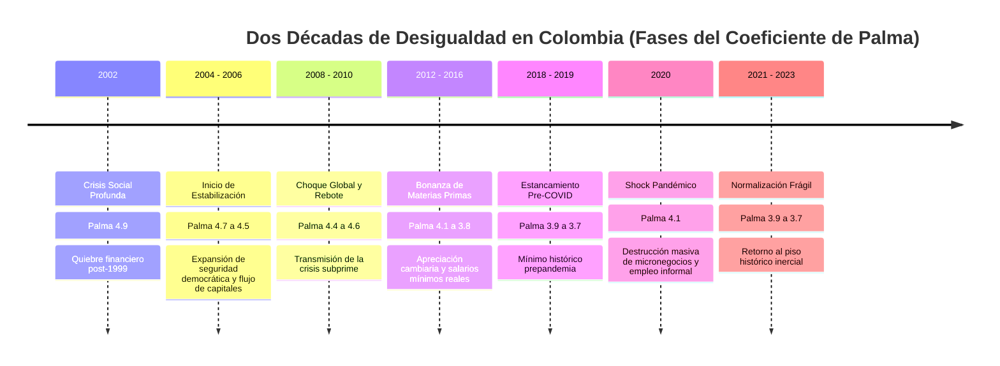

# 02. Anatomía Distributiva de Colombia (2002–2023)

> **Metadatos Canónicos:**  
> - **Dominio:** Dominio I — Marco Teórico y Conceptualización  
> - **Propósito:** Analizar la trayectoria temporal del Coeficiente de Palma en Colombia durante dos décadas, descomponiendo sus fases macroeconómicas, sus ciclos de materias primas y el impacto del shock pandémico.  
> - **Audiencia:** Economistas, formuladores de políticas públicas, historiadores económicos y agentes evaluadores.  
> - **Alcance:** Serie histórica de microdatos empalmados DANE (MESEP/GEIH) entre 2002 y 2023.  
> - **Límites de Validez:** Datos basados en encuestas de hogares urbanas y rurales; no incluye riqueza offshore ni activos inmobiliarios no transados.

---

## 1. La Inflexibilidad Estructural de la Brecha

A pesar de dos décadas de crecimiento económico sostenido, apertura comercial, reformas tributarias recurrentes y ampliación de programas de asistencia social condicionada, la desigualdad en Colombia exhibe una rigidez casi pétrea:

---

## 2. Análisis por Fases Históricas

### Fase 1: El Punto de Partida Crítico (2002–2006)
- **Valor de Palma:** $4.9 \rightarrow 4.5$.
- **Contexto Macroeconómico:** Secuelas de la peor crisis financiera de fin de siglo (1998–1999), desempleo urbano de dos dígitos ($>15\%$) y conflicto armado en su fase de mayor intensidad.
- **Mecánica Distributiva:** El 40% de la base capturaba menos del 10% del ingreso total, mientras el decil superior acaparaba casi la mitad de la masa monetaria, impulsado por rentas financieras y concentración agraria.

### Fase 2: La Bonanza Petrolera y Minera (2008–2016)
- **Valor de Palma:** $4.4 \rightarrow 3.8$.
- **Contexto Macroeconómico:** Términos de intercambio históricamente favorables debido al superciclo de commodities (*petróleo a más de 100 USD/barril*, carbón y níquel).
- **Mecánica Distributiva:**
  1. La apreciación del peso abarató bienes de consumo duradero y redujo la inflación de alimentos transables.
  2. El gobierno expandió programas de transferencias monetarias condicionadas (*Familias en Acción*).
  3. Los salarios mínimos reales crecieron moderadamente por encima de la productividad, fortaleciendo ligeramente a los deciles 3 y 4.
- **Resultado:** El Coeficiente de Palma cayó a un mínimo de **3.8** en 2016, que aun así mantenía a Colombia como uno de los países más desiguales de la OCDE y del continente.

### Fase 3: La Fractura del COVID-19 y la Vulnerabilidad Oculta (2020)
- **Valor de Palma:** Salto abrupto a **4.1** (+0.4 puntos en 12 meses).
- **Contexto Macroeconómico:** Confinamientos obligatorios, paralización de actividades presenciales en el comercio y servicios, y caída drástica de la recaudación fiscal.
- **Mecánica Distributiva:** La pandemia actuó como un catalizador de asimetrías. Mientras los trabajadores de cuello blanco y los rentistas pudieron mantener sus ingresos mediante teletrabajo y activos de capital, los deciles 1 a 4 (dependientes de la economía del rebusque diario y la informalidad laboral al 58%) perdieron la totalidad de su flujo corriente.
- **Amortiguadores:** La creación del programa *Ingreso Solidario* evitó una catástrofe humanitaria aún mayor, pero fue insuficiente para compensar la evaporación de ingresos laborales.

### Fase 4: La Recuperación Inercial (2021–2023)
- **Valor de Palma:** $3.9 \rightarrow 3.7$.
- **Contexto Macroeconómico:** Reactivación rápida del empleo por demanda acumulada, choque inflacionario post-pandemia en alimentos y energía, y reconfiguración de subsidios estatales.
- **Conclusión Estructural:** Para 2023, Colombia retornó a un Palma de **3.7**. Esto demuestra que la desigualdad colombiana posee un **suelo inercial**: las fuerzas automáticas de mercado y las transferencias focalizadas no logran perforar la barrera de 3.5 sin una reforma estructural al sistema productivo y tributario.
