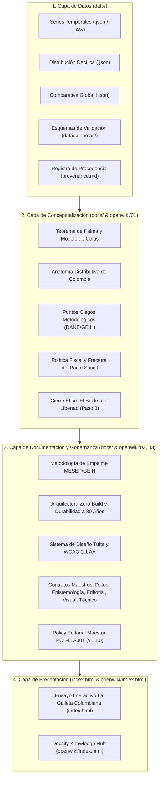

# DIAGNÓSTICO INTEGRAL Y SANITY DOCUMENTAL DEL REPOSITORIO
## Repositorio: colombia-palma-desigualdad (Paso 5: La Galleta Colombiana)
**Código Documental:** DIAG-REPO-20261109  
**Fecha:** 2026-11-09  
**Rol Auditor:** Agente de Arquitectura Documental, Gobernanza y Auditoría Epistemológica  
**Estado:** [CANÓNICO / CONSOLIDADO]

---

## 1. Contexto y Teleología del Repositorio

El repositorio `colombia-palma-desigualdad` alberga el **Paso 5 («Aterrizar»)** de **«La Ruta del Pensamiento Crítico»**, un ecosistema de 5 proyectos interactivos e investigativos desarrollados por William Camilo Artunduaga Viana (`@willkwolf`).

La teleología principal de este proyecto es:
1. Transferir conocimiento riguroso sobre la mecánica y relevancia del **Coeficiente de Palma** en Colombia (2002–2023), contrastándolo con el Coeficiente de Gini tradicional.
2. Demostrar la tesis de Gabriel Palma sobre la estabilidad distributiva de la clase media (deciles 5 al 9, ~50% del ingreso nacional) y la extrema concentración en la cola superior (decil 10) frente a la base (deciles 1 al 4).
3. Proveer una metáfora intuitiva pero isomórficamente estricta (la distribución de las «100 galletas») mediante un Waffle Chart interactivo.
4. Modelar la evolución histórica colombiana mediante un gráfico de líneas tipo Tufte Range-Frame sin «factor de mentira» (*Lie Factor*), mostrando cómo Colombia oscila en valores de Palma críticos entre 3.7 y 4.9.
5. Conectar la desigualdad material con la fractura del pacto social y las libertades reales, cerrando el bucle reflexivo hacia el Paso 3 (*Anatomía de la Libertad - Isaiah Berlin*).

---

## 2. Inventario y Clasificación de Documentos Pre-Intervención

| Identificador | Ruta Pre-Intervención | Función Asignada | Estado y Diagnóstico | Decisión Arquitectónica |
| :--- | :--- | :--- | :--- | :--- |
| **DOC-01** | `index.html` | Derivado / Presentación / Canónico Mixto | Monolito de 2,359 líneas. Contiene la presentación visual interactiva, pero acopla indebidamente en sus scripts los datos empíricos brutos (`HISTORICAL_DATA`, `PALMA_DISTRIBUTION`). | **Preservar como artefacto de presentación principal**, pero desacoplar los datos hacia la capa canónica `data/`. |
| **DOC-02** | `README.md` | Operativo / Referencia Mixto | 146 líneas. Presenta el proyecto y resume la teoría de Palma, pero mezcla teoría con fragmentos de código de mantenimiento (`HISTORICAL_DATA = [...]`), sin una separación formal de responsabilidades. | **Actualizar y profesionalizar en FASE 6**, separando la gobernanza, arquitectura y citación de la documentación técnica. |
| **DOC-03** | `.github/workflows/deploy.yml` | Operativo | Workflow de CI/CD que corre `htmlhint` y despliega en GitHub Pages. | **Preservar y extender** para soportar el arnés de gobernanza y despliegue del ecosistema completo. |
| **DOC-04** | `skills-lock.json` | Operativo / Herramientas de Agente | Archivo de bloqueo de habilidades de agentes autónomos. | **Preservar intacto**. |
| **DOC-05** | `.agents/skills/*` | Operativo / Referencia | Habilidades instaladas para la asistencia de agentes en investigación y código. | **Preservar intacto**. |

---

## 3. Hallazgos Epistemológicos, Estructurales y de Gobernanza

### 3.1. Acoplamiento de Capas (Datos incrustados en Presentación)
- **Problema:** Los datos de la serie histórica (2002–2023) y la distribución porcentual por deciles no existían como datasets independientes en formatos estándar (`.json` o `.csv`), sino como variables internas de JavaScript en el tag `<script>` de `index.html`.
- **Riesgo Epistémico:** Cualquier agente o investigador que necesitara validar o reutilizar las cifras debía parsear código de interfaz de usuario. No existían esquemas JSON (`.schema.json`) ni contratos que validaran la integridad de los datos.

### 3.2. Ausencia de Base de Conocimiento Estructurada (OpenWiki)
- **Problema:** A diferencia del proyecto hermano `isaiah-berlin-liberty-infographic`, este repositorio carecía de una arquitectura OpenWiki con Docsify. La fundamentación teórica de Gabriel Palma, la discusión metodológica sobre el subreporte de capitales en la GEIH del DANE y los dilemas de economía política estaban confinados al texto del monólogo en `index.html`.
- **Riesgo:** Pérdida de profundidad académica y dificultad para que agentes futuros auditen las premisas teóricas sin descomponer el código visual.

### 3.3. Cero Contratos Formales de Gobernanza
- **Problema:** No existían contratos explícitos que regularan qué puede modificar un agente, cómo se audita la correspondencia semántica de los gráficos, ni qué constituye una alteración inaceptable de las tesis autorales (*Conceptual Drift*).
- **Riesgo:** Degradación potencial del rigor académico ante intervenciones automatizadas o refactorizaciones cosméticas.

### 3.4. Puntos de Entrada Ambiguos
- **Problema:** Un agente o investigador que ingresara al repositorio solo disponía de un `README.md` corto y un archivo monolítico `index.html`. No había un mapa de lectura estructurado, ni guía de procedencia de datos, ni registro de decisiones arquitectónicas o editoriales.

---

## 4. Plan de Saneamiento y Separación Canónica

Para subsanar las deficiencias detectadas, se establece la siguiente partición estricta:

---

## 5. Criterio de Eliminación y Consolidación de Archivos

- **No se detectaron archivos huérfanos o espurios preexistentes:** El repositorio original contenía únicamente el archivo interactivo, el workflow de despliegue y la configuración de habilidades.
- **Consolidación activa:** La información que se encontraba fragmentada o implícita en comentarios de código se formaliza en documentos canónicos específicos bajo `/data` y `/docs`.
- **Preservación:** No se elimina código ni contenido legítimo; se extrae el conocimiento hacia artefactos independientes gobernados.
