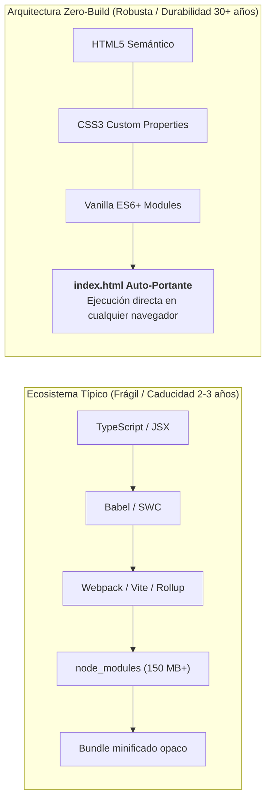

# 01. Arquitectura Zero-Build Monolítica y Preservación Digital

> **Metadatos Canónicos:**  
> - **Dominio:** Dominio II — Tecnología, Arquitectura e Isomorfismo Visual  
> - **Propósito:** Formalizar los principios de la arquitectura Zero-Build, la inmunidad a la obsolescencia tecnológica y la preservación digital a largo plazo (horizonte de 30 años).  
> - **Audiencia:** Desarrolladores web, arquitectos de software, archivistas digitales y agentes de mantenimiento.  
> - **Alcance:** Implementación monolítica en `index.html` sin pasos de transpilación, bundlers ni dependencias de runtime.  
> - **Criterio Normativo:** Invariante Zero-Build ([VIGENTE] en CON-TEC-001).

---

## 1. El Manifiesto Zero-Build: Rechazo a la Fragilidad Efímera

El ecosistema web contemporáneo sufre de una epidemia de obsolescencia acelerada: proyectos desarrollados hace apenas cinco años con versiones antiguas de Webpack, Babel o frameworks SPA hoy son incapaces de compilar debido a dependencias deprecadas, vulnerabilidades en el árbol de `node_modules` o rupturas en APIs de NodeJS.

Para un artefacto que aspira a ser una **pieza de archivo académico y divulgación cívica perdurable**, esta fragilidad es inaceptable.

> **Principio de Auto-Suficiencia Estricta:**  
> El artefacto interactivo principal reside en un único archivo canónico de producción (`index.html`) que integra de forma autónoma:
> 1. Marcado semántico HTML5 estructurado.
> 2. Estilos encapsulados mediante variables nativas CSS3.
> 3. Lógica reactiva en JavaScript ES6+ sin framework alguno.

---

## 2. Invariantes de Ingeniería

1. **Cero Compilación en Runtime:**  
   No se requiere `npm install`, ni `vite build`, ni servidores de desarrollo dedicados. Un investigador en el año 2040 puede descargar el archivo, hacer doble clic sobre él en cualquier sistema operativo y la aplicación funcionará de manera idéntica.
2. **Fuentes Abiertas y Fallbacks Nativos:**  
   Se importan tipografías editoriales de alta calidad (*EB Garamond*, *Cabin*, *DM Mono* via Google Fonts CDN), pero se configuran fallbacks tipográficos robustos del sistema (`Georgia`, `serif`, `system-ui`, `monospace`) para que la legibilidad nunca se degrade si no hay conexión a internet.
3. **Desacoplamiento de Datos:**  
   Aunque el archivo `index.html` es auto-portante para consumo público inmediato, los datos empíricos son extraídos canónicamente a la capa `data/` (`palma_colombia_series.json` y `.csv`) para permitir auditorías externas independientes.
