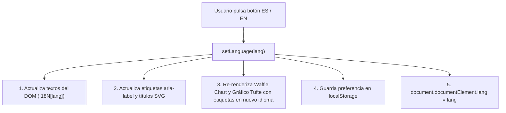

# 04. Motor de Internacionalización Reactivo (i18n) sin Dependencias

> **Metadatos Canónicos:**  
> - **Dominio:** Dominio II — Tecnología, Arquitectura e Isomorfismo Visual  
> - **Propósito:** Documentar la implementación del motor reactivo de internacionalización bilingüe (Español / Inglés) desarrollado en Vanilla JavaScript sin dependencias externas.  
> - **Audiencia:** Desarrolladores frontend, traductores, editores bilingües y agentes de verificación de paridad lingüística.  
> - **Alcance:** Diccionario i18n estructurado, conmutación reactiva en tiempo de ejecución, actualización de atributos DOM/ARIA y persistencia en `localStorage`.  
> - **Criterio Normativo:** Paridad Semántica Estricta 1:1 ([VIGENTE] en CON-EDT-001).

---

## 1. Arquitectura del Motor de Traducción

Para mantener la política *Zero-Build* monolítica sin recurrir a bibliotecas pesadas como `i18next` o compiladores de plantillas, el sistema implementa un motor declarativo simple pero de alto rendimiento:

1. **Diccionario Centralizado:** Un objeto literal `const I18N` que estructura pares clave-valor simétricos para español (`es`) e inglés (`en`).
2. **Selectores Declarativos en el DOM:** Los elementos de la interfaz poseen atributos de datos o IDs semánticos vinculados a claves del diccionario (`data-i18n`, `id="txt-..."`).
3. **Paso de Actualización Atómica:** La función `setLanguage(lang)` recorre los nodos vinculados y actualiza simultáneamente:
   - Contenido de texto (`textContent` o `innerHTML` seguro).
   - Atributos accesibles (`aria-label`, `title`, `placeholder`).
   - El atributo `lang` en el elemento `<html>`.
   - El estado visual y los atributos `aria-pressed` de los botones de cambio de idioma (`#btn-lang-es`, `#btn-lang-en`).
   - Persistencia local en `localStorage.setItem('user_lang', lang)`.

---

## 2. Re-Renderizado Gráfico Bilingüe

A diferencia de las aplicaciones web convencionales donde los gráficos son estáticos o generados como imágenes bitmap, en *La Galleta Colombiana*:
- El Waffle Chart regenera dinámicamente sus anuncios de accesibilidad (ej. *«Cookie #1 · 40% Bottom Deciles»* vs. *«Galleta #1 · 40% Vulnerable»*).
- El gráfico SVG Tufte recalcula los títulos de ejes y las cajas de notas históricas de cada punto en el idioma seleccionado sin recargar la página.

---

## 3. Paridad Semántica Estricta (Regla Anti-Asimetría)

El Contrato de Gobernanza Editorial (`CON-EDT-001`) impone una regla infranqueable: **prohibido publicar contenido en español sin su correlato fiel en inglés, y viceversa**. Cada nota histórica en `HISTORICAL_DATA` cuenta con `note_es` y `note_en`, y cada comparador global dispone de su glosa explicativa bilingüe.
