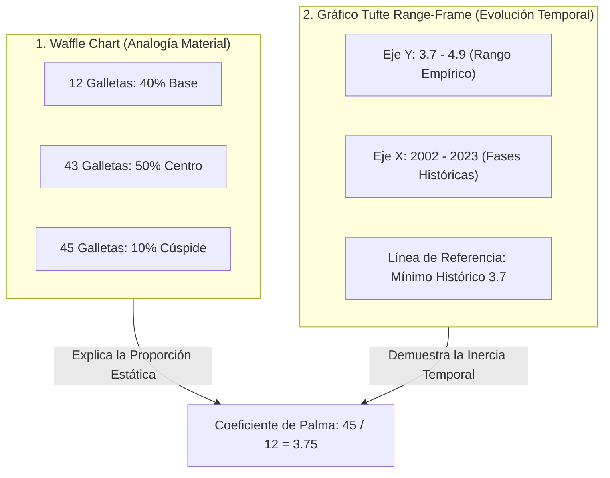

# 02. Sistema de Diseño Tufte y Ratio Datos-Tinta (Data-Ink Ratio)

> **Metadatos Canónicos:**  
> - **Dominio:** Dominio II — Tecnología, Arquitectura e Isomorfismo Visual  
> - **Propósito:** Definir los principios de comunicación visual inspirados en Edward Tufte, el diseño de museografía técnica y el estricto isomorfismo semántico de las visualizaciones interactivas.  
> - **Audiencia:** Diseñadores de información, desarrolladores frontend, editores gráficos y auditores de accesibilidad visual.  
> - **Alcance:** Gráfico de líneas Range-Frame en SVG, Waffle Chart de 100 galletas y paleta cromática sobria.  
> - **Criterio Normativo:** Isomorfismo Semántico y Cero Chartjunk ([VIGENTE] en CON-VIZ-001).

---

## 1. Principios de Edward Tufte Aplicados

El diseño visual de *La Galleta Colombiana* adopta los axiomas clásicos de Edward Tufte (*The Visual Display of Quantitative Information*, 1983):

1. **Maximización del Ratio Datos-Tinta (*Data-Ink Ratio*):**  
   Cada trazo de píxel o vector en la pantalla debe corresponder a una variación de información sustantiva. Se eliminan cuadrículas pesadas, bordes tridimensionales, sombras proyectadas no funcionales y gradientes cosméticos (*chartjunk*).
2. **Gráfico de Marco Acotado (*Range-Frame Line Chart*):**  
   Los ejes $X$ e $Y$ no se extienden arbitrariamente hacia ceros artificiales o extremos vacíos. El eje vertical abarca estrictamente el recorrido observable de los datos ($3.7$ a $4.9$), y el eje horizontal recorre exactamente desde $2002$ hasta $2023$, haciendo explícito el rango empírico sin distorsión.
3. **Cero Factor de Mentira (*Lie Factor = 1.0*):**  
   El tamaño del efecto visual en la pantalla es estrictamente proporcional al tamaño del efecto en los datos estadísticos:
   $$\text{Lie Factor} = \frac{\text{Tamaño del efecto visual en pantalla}}{\text{Tamaño del efecto real en los datos}} \equiv 1.0$$

---

## 2. Anatomía de los Artefactos Visuales

### 2.1. El Waffle Chart de las 100 Galletas
- **Metáfora Isomórfica:** La totalidad de los ingresos generados en Colombia en un año se condensan en 100 unidades discretas («galletas»).
- **Correspondencia 1:1:**
  - **40% de la población (Deciles 1–4):** Recibe únicamente **12 galletas** (un promedio miserable de $0.3$ galletas por persona/hogar).
  - **50% de la población (Deciles 5–9):** Recibe **43 galletas** (cercano al equilibrio de Palma de $0.86$ galletas por persona).
  - **10% superior (Decil 10):** Captura **45 galletas** ($4.5$ galletas por persona).
- **Interactividad A11y:** Cada galleta es un botón interactivo enfocable por teclado (`tabindex="0"`) con anuncio sonoro vía `aria-label` y tooltip flotante no intrusivo.

### 2.2. El Trazador SVG Dinámico (Serie 2002–2023)
- **Generación Vectorial Matemática:** El trazador calcula las coordenadas cartesianas mediante interpolación lineal fluida en SVG nativo (`viewBox="0 0 860 360"`).
- **Anotaciones Críticas de Fase:** Puntos clave de inflexión (Crisis 2002, Mínimo de Bonanza 2016, Salto COVID 2020 y Suelo 2023) cuentan con placas tipográficas contrastadas que previenen la colisión visual de etiquetas (*anti-collision text layout*).

---

## 3. Paleta Cromática y Tokens Editoriales

Inspirada en el estilo de papel editorial envejecido y tipografía de museo:

| Token CSS | Hexadecimal | Función Semántica | Ratio de Contraste s/Papel |
| :--- | :---: | :--- | :---: |
| `--cream` | `#F5EDD8` | Fondo principal tipo papel museo | — |
| `--paper` | `#EDE4CC` | Tarjetas y contenedores secundarios | — |
| `--ink` | `#181108` | Texto principal de lectura (EB Garamond) | **13.8:1** (AAA) |
| `--brown` | `#5C3219` | Masthead, divisores y titulares de sección | **7.2:1** (AAA) |
| `--rust` | `#AA3217` | Alerta de desigualdad extrema (Decil 10 / Colombia) | **5.2:1** (AA) |
| `--forest` | `#225633` | Paridad nórdica y mejoras distributivas | **6.8:1** (AA) |
| `--gold` | `#D6971E` | Acentos, indicadores de foco y bordes masthead | **3.8:1** (Gráficos) |
| `--focus-ring` | `#005A9C` | Anillo de enfoque accesible de alto contraste | **7.4:1** (AAA) |
