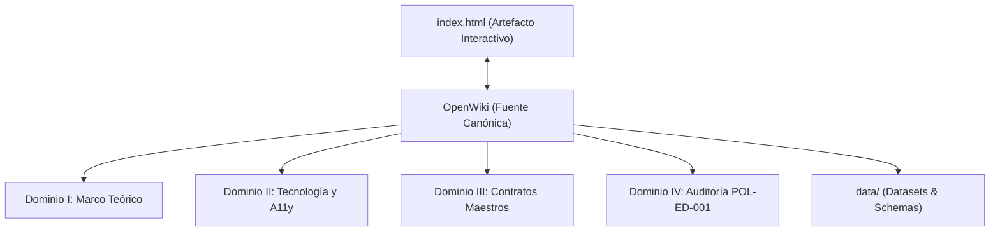
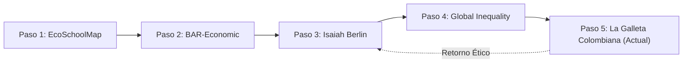

# OpenWiki — La Galleta Colombiana
## Centro Canónico de Documentación, Gobernanza del Conocimiento y Fuente de Verdad Operativa
**Paso 5 de la Ruta del Pensamiento Crítico:** *Radiografía de la Desigualdad y Coeficiente de Palma en Colombia*  
**Autor:** William Camilo Artunduaga Viana (`@willkwolf`)  
**Licencia:** Creative Commons Attribution 4.0 International (CC BY 4.0)

---

## 1. Propósito de OpenWiki

Este centro de conocimiento estructurado constituye la **fuente canónica de verdad** para investigadores, lectores avanzados, copilotos y agentes autónomos de IA. Aquí se fundamenta formalmente:

1. **La Teoría Económica:** Por qué el Coeficiente de Palma supera al Coeficiente de Gini para capturar el poder distributivo real en economías extractivas y en desarrollo.
2. **La Evidencia Empírica:** Cómo se procesan y empalman los microdatos del DANE (MESEP / GEIH 2002–2023) y cuáles son sus sesgos estructurales conocidos.
3. **La Arquitectura Técnica:** Por qué se adopta un diseño *Zero-Build* monolítico con tipografía Tufte y accesibilidad WCAG 2.1 AA para garantizar durabilidad a 30 años sin deuda técnica.
4. **Los Contratos de Gobierno:** El sistema normativo que previene la degradación conceptual, el sesgo partidista y la alteración inadvertida de las tesis del autor.

---

## 2. Mapa de Navegación por Dominios

### [Dominio I: Marco Teórico y Conceptualización](01-marco-teorico/01-fundamentos-teorema-palma.md)
* **01. Teorema de Palma y Modelo de Colas:** La hipótesis del 50% medio estable y la disputa en los extremos.
* **02. Anatomía Distributiva de Colombia (2002–2023):** Análisis de fases históricas: crisis, bonanza de materias primas, pandemia y estancamiento.
* **03. Puntos Ciegos y Límites Metodológicos:** Flujo vs. riqueza, subreporte de capitales y asimetría centro-periferia.
* **04. Política Fiscal y Fractura del Pacto Social:** El fracaso redistributivo de la tributación indirecta.
* **05. Cierre Ético: El Bucle a la Libertad:** Vínculo epistemológico con el Paso 3 (*Isaiah Berlin y la Libertad Negativa vs. Positiva*).

### [Dominio II: Tecnología, Arquitectura e Isomorfismo Visual](02-tecnologia-y-arquitectura/01-arquitectura-zero-build.md)
* **01. Arquitectura Zero-Build Monolítica:** Estándares web nativos sin Node/Vite/Webpack en producción.
* **02. Sistema de Diseño Tufte:** Gráficos Range-Frame sin *Lie Factor*, Waffle Chart accesible y ratio datos-tinta.
* **03. Accesibilidad Universal (WCAG 2.1 AA):** Ratios de contraste $\ge 4.5:1$, navegación por teclado y lectores de pantalla.
* **04. Motor de Internacionalización Reactivo:** Diccionario bilingüe (ES/EN) con persistencia y paridad 1:1.

### [Dominio III: Contratos Maestros y Gobernanza](03-contratos-y-tests/01-contrato-gobernanza-datos.md)
* **01. Contrato de Gobernanza de Datos (CON-DAT-001):** Procedencia, esquemas y reproducibilidad.
* **02. Contrato de Gobernanza Epistemológica (CON-EPI-001):** Falibilismo, neutralidad y rigor causal.
* **03. Contrato de Gobernanza Editorial (CON-EDT-001):** Estilo Tufte, paridad i18n y citación académica APA 7 / BibTeX.
* **04. Contrato de Gobernanza Visual (CON-VIZ-001):** Isomorfismo semántico, tokens de color y touch targets $\ge 44 \times 44\text{ px}$.
* **05. Contrato de Gobernanza Técnica y Publicación (CON-TEC-001):** Invariantes de código y pipeline CI/CD.
* **06. Policy Editorial Maestra POL-ED-001 (v1.1.0):** Norma transversal de auditoría con los 8 vectores y anexos oficiales.

### [Dominio IV: Auditoría Epistemológica y Decisiones](04-auditoria/01-informe-auditoria-pol-ed-001.md)
* **01. Ficha Oficial de Auditoría:** Evaluación según la plantilla canónica `AUDIT_REPORT_TEMPLATE.md` y checklist de 20 puntos.
* **02. Registro de Decisiones Editoriales (E-ADR):** Justificación formal de excepciones y blindaje anti-drift.

---

## 3. La Ruta del Pensamiento Crítico

